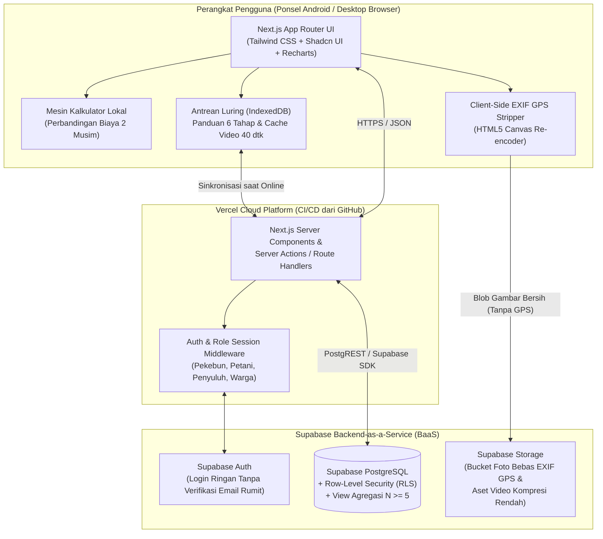
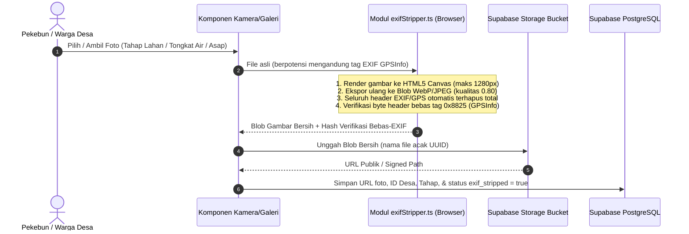
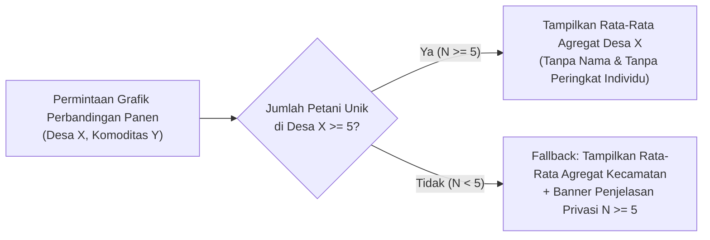

# Arsitektur Sistem & Infrastruktur — Jaga Lahan

**Proyek:** Jaga Lahan — Aplikasi Web Progresif (PWA) Pendamping Pembukaan Lahan Tanpa Bakar  
**Versi Dokumen:** 1.0.0  
**Stack Utama:** Next.js 15 (App Router, TypeScript) • Tailwind CSS • Shadcn UI • Supabase (PostgreSQL, Auth, Storage, RLS) • Vercel • GitHub  

---

## 1. Prinsip Arsitektur Utama

Arsitektur **Jaga Lahan** dirancang khusus untuk menjawab kondisi riil wilayah perdesaan gambut di Sumatera dan Kalimantan:

1. **Offline-First & Low-Bandwidth Friendly:** Petani tetap dapat menggunakan *Kalkulator Bakar vs. Tanpa Bakar*, membaca *Panduan 6 Tahap*, serta menginput angka *Tongkat Ukur Muka Air Tanah* dan *Jurnal Hasil Panen* saat berada di kebun tanpa sinyal seluler. Data disimpan di antrean lokal (`IndexedDB` / `localStorage`) dan disinkronkan otomatis saat perangkat kembali terhubung ke internet (balai desa atau rumah).
2. **Privacy-by-Design di Sisi Klien (Client-Side Privacy Gate):** Pembersihan metadata lokasi (`EXIF GPS`) pada foto kemajuan tahap atau foto tongkat ukur dilakukan **sepenuhnya di peramban perangkat pengguna (client-side Canvas re-encoding)** sebelum berkas gambar pernah dikirim ke jaringan menuju Supabase Storage.
3. **Zero-Coordinate Storage:** Skema basis data dan API sama sekali tidak memiliki kolom koordinat lintang/bujur (`latitude`/`longitude`) atau poligon `GeoJSON` untuk profil petani, lahan, maupun jurnal panen. Resolusi spasial tertinggi yang disimpan adalah kode dan nama **Desa (`village_id`)**.
4. **Mobile-First Responsive Shell:** Meskipun diakses melalui peramban web (tanpa paksaan unduh APK besar di toko aplikasi), antarmuka dibungkus dalam *Mobile App Shell* (`max-w-md mx-auto`) yang mendukung instalasi *Add to Home Screen* (PWA) di ponsel Android kelas pemula dan tetap menampilkan dasbor komparatif yang rapi saat dibuka di layar laptop/proyektor untuk presentasi.

---

## 2. Diagram Arsitektur Sistem End-to-End



---

## 3. Alur Kritis Privasi & Sinkronisasi Luring

### 3.1 Pipeline Penghapusan Metadata EXIF GPS (Client-Side)

Sesuai komitmen etika pada Bagian F esai dan UU Pelindungan Data Pribadi (UU No. 27 Tahun 2022), foto yang diunggah petani **dilarang keras** membawa koordinat GPS perangkat:



### 3.2 Alur Agregasi Aman $N \ge 5$ pada Jurnal Panen Desa

Untuk mencegah identifikasi balik (*re-identification*) terhadap hasil panen individu di desa yang baru memiliki sedikit pengguna, basis data menerapkan aturan ambang batas minimal lima catatan petani ($N \ge 5$):



---

## 4. Struktur Direktori Proyek Next.js (`JagaLahan/`)

Saat tahap inisialisasi kode dimulai (Fase 1), struktur repositori akan diorganisasikan secara modular sebagai berikut:

```text
JagaLahan/
├── docs/                                  # Dokumentasi lengkap proyek (PRD, Arsitektur, DB, Desain, Etika)
│   ├── README.md
│   ├── PRD.md
│   ├── ARCHITECTURE.md
│   ├── DATABASE_SCHEMA.md
│   ├── DESIGN_SYSTEM.md
│   ├── ETHICS_AND_PRIVACY.md
│   ├── ROADMAP.md
│   └── CHANGELOG.md
├── public/
│   ├── logo-jagalahan.png                 # Logo resmi Jaga Lahan
│   ├── manifest.json                      # Konfigurasi PWA (Add to Home Screen)
│   └── media/                             # Ilustrasi panduan 6 tahap & tongkat ukur air
├── src/
│   ├── app/                               # Next.js App Router
│   │   ├── layout.tsx                     # Root layout + Font + Banner Status Offline/Privasi
│   │   ├── page.tsx                       # Landing / Onboarding 3 Layar & Pemilihan Peran Desa
│   │   ├── (app)/                         # Shell Aplikasi Utama (dengan Bottom Navigation)
│   │   │   ├── beranda/page.tsx           # Dasbor Kalimat Pengingat Pra-Keputusan (H-21/H-14/H-7)
│   │   │   ├── kalkulator/page.tsx        # F-02: Kalkulator Bakar vs. Tanpa Bakar + Modal Rumus
│   │   │   ├── panduan/page.tsx           # F-03: Panduan 6 Tahap + Video 40d + Pengingat Hari ke-10
│   │   │   ├── muka-air/page.tsx          # F-04: Tongkat Ukur Muka Air Tanah (3 Zona PP 57/2016)
│   │   │   ├── jurnal-panen/page.tsx      # F-05: Jurnal Hasil Panen & Perbandingan Agregat Desa (N>=5)
│   │   │   ├── kohort-desa/page.tsx       # F-06: Kohort Desa, Lencana Kolektif, & Antrean Alat Cacah
│   │   │   ├── pantau-asap/page.tsx       # F-08: Lapor Asap Dini & Pantau Lahan Pasca-Kebakaran (6-12 bln)
│   │   │   └── penyuluh/page.tsx          # Panel Verifikasi Penyuluh Tersier & Manajemen Harga Acuan
│   │   └── api/                           # Route Handlers (Sinkronisasi Luring & Audit Log)
│   ├── components/
│   │   ├── ui/                            # Komponen dasar Shadcn UI (Button, Card, Dialog, Tabs, Badge)
│   │   ├── layout/                        # MobileShell, BottomNav, OfflineIndicator, RoleSwitcher
│   │   ├── calculator/                    # CostComparisonCard, FormulaTransparencyModal, AidRequestSheet
│   │   ├── guide/                         # SixStageStepper, CompostFlipReminderCard
│   │   ├── water-level/                   # DipstickVisualizer, WaterZoneChart, ActionCalloutCard
│   │   ├── harvest/                       # HarvestEntryForm, VillageAggregateChart, PrivacyThresholdNotice
│   │   └── community/                     # VillageBadgeGrid, CommitmentToggleCard, PostFireTimeline
│   ├── lib/
│   │   ├── supabase/
│   │   │   ├── client.ts                  # Browser Supabase client
│   │   │   └── server.ts                  # Server-side Supabase client
│   │   ├── privacy/
│   │   │   ├── exif-stripper.ts           # Utilitas penghapus EXIF GPS via HTML5 Canvas
│   │   │   └── aggregation-guard.ts       # Validator aturan N >= 5 & larangan koordinat
│   │   ├── calculator/
│   │   │   └── cost-engine.ts             # Rumus transparan Bakar vs. Tanpa Bakar (Musim 1 & 2)
│   │   └── offline/
│   │       └── sync-queue.ts              # Penyimpanan lokal & sinkronisasi saat koneksi pulih
│   └── types/
│       └── database.types.ts              # Definisi tipe TypeScript yang sinkron dengan Supabase
├── .env.example                           # Template variabel lingkungan (tanpa rahasia)
├── package.json
├── tailwind.config.ts
└── tsconfig.json
```

---

## 5. Pemetaan Komponen ke Kerangka Teoretis Persuasive Technology

Setiap lapisan arsitektur teknis di atas berkorespondensi langsung dengan kerangka *Functional Triad* (Fogg, 2002) dan prinsip persuasi (Cialdini, 2007):

| Lapisan Teknis / Modul | Peran *Functional Triad* | Mekanisme Teknis yang Diterapkan |
| :--- | :--- | :--- |
| **`src/lib/calculator/cost-engine.ts`** | **Alat (*Tool*) — *Reduction*** | Menghitung rincian upah kerja, sewa alat cacah, kapur dolomit, dan proyeksi musim kedua secara instan dari 3 input sederhana; dilengkapi modal transparansi rumus. |
| **`src/components/guide/SixStageStepper.tsx`** | **Alat (*Tool*) — *Tunneling* & *Tailoring*** | Menyajikan 6 langkah berurutan yang disesuaikan dengan jenis tanah (gambut/mineral) dan vegetasi semak, namun tetap menyediakan tombol *"Lewati / Kembali"* (non-koersif). |
| **`src/components/water-level/DipstickVisualizer.tsx`** | **Alat (*Tool*) & Media — *Self-Monitoring* & *Simulation*** | Memetakan angka sentimeter tongkat ukur ke grafik 4 minggu dan 3 zona warna+ikon+pola berdasarkan ambang batas $0,4\text{ meter}$ ($40\text{ cm}$) pada PP No. 57 Tahun 2016. |
| **`src/components/community/VillageBadgeGrid.tsx`** | **Aktor Sosial (*Social Actor*) — *Social Proof*, *Reciprocity*, *Commitment*** | Menampilkan agregat hektare desa bebas bakar, lencana kolektif desa, opsi komitmen sukarela (publik/pribadi), dan pembukaan akses gilir alat pencacah desa. |
| **`src/lib/privacy/exif-stripper.ts`** | **Pelindung Etika & Privasi (UU PDP No. 27/2022)** | Menghapus seluruh metadata lokasi EXIF pada foto di sisi klien dan memastikan tidak ada data lokasi presisi tinggi yang dikirim ke server. |

---

## 6. Alur Deployment & Integrasi (GitHub $\rightarrow$ Vercel $\leftrightarrow$ Supabase)

1. **Repositori Kode Sumber (GitHub):**
   - Cabang utama (`main`) dilindungi dan terhubung langsung ke proyek Vercel.
   - Setiap *commit* mengikuti konvensi *Conventional Commits* (`feat:`, `fix:`, `docs:`) dan tercatat di [`CHANGELOG.md`](file:///D:/S2%20Amikom/Persuasive%20Technology/JagaLahan/docs/CHANGELOG.md).
2. **Database & Storage (Supabase):**
   - Skema tabel, *View* agregasi $N \ge 5$, data awal (*seed data* desa percontohan di Kalimantan Tengah & Riau), serta kebijakan *Row-Level Security (RLS)* dikelola melalui migrasi SQL yang terdokumentasi di [`DATABASE_SCHEMA.md`](file:///D:/S2%20Amikom/Persuasive%20Technology/JagaLahan/docs/DATABASE_SCHEMA.md).
3. **Hosting & Edge Network (Vercel):**
   - Variabel lingkungan yang dikonfigurasi pada Vercel & `.env.local`:
     - `NEXT_PUBLIC_SUPABASE_URL`: URL instance proyek Supabase.
     - `NEXT_PUBLIC_SUPABASE_ANON_KEY`: Kunci publik (*anon key*) yang diamankan dengan kebijakan RLS PostgreSQL.
   - Menyediakan URL produksi berprotokol HTTPS yang siap diuji langsung di peramban ponsel maupun desktop serta siap diambil tangkapan layarnya (*screenshots*) untuk lampiran visual karya ilmiah.

