# Skema Basis Data & Kebijakan Keamanan (Supabase PostgreSQL) — Jaga Lahan

**Proyek:** Jaga Lahan  
**Versi Dokumen:** 1.0.0  
**DBMS:** PostgreSQL 15+ (via Supabase) dengan *Row-Level Security (RLS)*  

---

## 1. Prinsip Desain Basis Data (Privacy-by-Schema)

Skema basis data **Jaga Lahan** dirancang untuk menegakkan aturan etika dan privasi secara struktural di tingkat mesin basis data (*database-enforced ethics*):

1. **Tanpa Kolom Koordinat Spasial (`Zero-GIS Policy`):** Tidak ada satu pun tabel yang menyimpan tipe data `POINT`, `POLYGON`, `GEOMETRY`, ataupun kolom `latitude` dan `longitude`. Lokasi pengguna dan lahan hanya direpresentasikan pada tingkat administratif **Desa (`village_id`)**.
2. **Aturan Privasi Agregat $N \ge 5$:** Perbandingan hasil panen tidak pernah mengembalikan baris milik petani individu lain. Aplikasi membaca melalui tampilan SQL (`v_safe_harvest_aggregates`) yang secara otomatis menyembunyikan rata-rata tingkat desa apabila jumlah petani unik di desa tersebut kurang dari 5 orang ($N < 5$), lalu mengalihkannya (*fallback*) ke rata-rata tingkat kecamatan.
3. **Verifikasi Bebas-EXIF Wajib (`exif_stripped_verified`):** Setiap tabel yang menyimpan URL foto memiliki constraint `CHECK (exif_stripped_verified = true)` untuk memastikan hanya foto yang telah melewati pembersih EXIF di sisi klien yang dapat disimpan.
4. **Dukungan Mode Simulasi / Demo Akademik:** Selain autentikasi pengguna nyata melalui Supabase Auth, skema menyediakan *seed data* realistis untuk desa percontohan (mis. Desa Kalampangan, Kalimantan Tengah & Desa Lukun, Riau) sehingga seluruh skenario persuasi dapat diuji dan didemonstrasikan secara utuh.

---

## 2. Diagram Hubungan Entitas (Entity-Relationship Diagram)

```mermaid
erDiagram
    VILLAGES ||--o{ PROFILES : "memiliki warga/petani"
    VILLAGES ||--o{ CALCULATOR_PRICE_REFS : "memiliki acuan harga lokal"
    VILLAGES ||--o{ VILLAGE_BADGES : "meraih lencana kolektif"
    VILLAGES ||--o{ SMOKE_REPORTS : "menerima laporan asap dini"
    VILLAGES ||--o{ POST_FIRE_PLOTS : "memantau lahan pasca-bakar"

    PROFILES ||--o{ SEASON_COMMITMENTS : "membuat komitmen musim"
    PROFILES ||--o{ WATER_TABLE_LOGS : "mencatat tinggi muka air"
    PROFILES ||--o{ HARVEST_JOURNALS : "mencatat panen musiman"
    PROFILES ||--o{ EQUIPMENT_REQUESTS : "mengajukan pinjam alat/bibit"

    SEASON_COMMITMENTS ||--o{ SIX_STAGE_PROGRESS : "melacak 6 tahap"
    POST_FIRE_PLOTS ||--o{ POST_FIRE_OBSERVATIONS : "memiliki observasi bulanan"

    VILLAGES {
        uuid id PK
        varchar village_code UK
        varchar village_name
        varchar district_name "Kecamatan (untuk fallback N < 5)"
        varchar regency_name "Kabupaten/Kota"
        varchar province_name "Provinsi"
        numeric target_zero_burn_ha
        int consecutive_zero_burn_seasons
        int available_chopper_units "Unit mesin pencacah desa"
        numeric available_cover_crop_kg "Stok benih penutup tanah (kg)"
    }

    PROFILES {
        uuid id PK
        uuid auth_user_id FK
        uuid village_id FK
        varchar display_name
        varchar role "pekebun_primer | petani_sekunder | penyuluh_tersier | warga_penjaga"
        varchar dominant_soil_type "gambut | mineral"
        numeric default_land_area_ha "Luas umum dalam ha (tanpa koordinat GPS)"
        date next_planting_date "Tanggal rencana buka lahan (pemicu H-21/14/7)"
        int ignored_reminder_count "Maks 3x sebelum berhenti otomatis"
    }

    CALCULATOR_PRICE_REFS {
        uuid id PK
        uuid village_id FK
        varchar soil_type "gambut | mineral"
        varchar vegetation_density "ringan | sedang | tebal"
        int burn_labor_cost_per_ha
        int burn_ash_handling_per_ha
        int zeroburn_chop_labor_per_ha
        int zeroburn_chopper_rental_per_ha
        int zeroburn_dolomite_decomposer_per_ha
        int season2_fertilizer_saving_per_ha
        uuid verified_by_penyuluh FK
        timestamptz updated_at
    }

    SEASON_COMMITMENTS {
        uuid id PK
        uuid profile_id FK
        uuid village_id FK
        varchar season_label "Mis: Kemarau 2026"
        numeric committed_area_ha
        varchar soil_type "gambut | mineral"
        varchar vegetation_density "ringan | sedang | tebal"
        boolean is_public_to_village "True: tampil di Kohort Desa, False: Pribadi"
        varchar status "berjalan | tuntas_tanpa_bakar | butuh_pendampingan"
        timestamptz created_at
    }

    SIX_STAGE_PROGRESS {
        uuid id PK
        uuid commitment_id FK
        int stage_number "1 s.d. 6"
        varchar stage_slug "penilaian | pencacahan | penumpukan | pengomposan | kesiapan | penanaman"
        varchar status "belum | sedang_dikerjakan | selesai | dilewati"
        date started_at
        date mulch_flip_due_date "Hari ke-10 untuk tahap 4 (pengomposan)"
        boolean mulch_flipped
        text photo_url "Foto opsional bebas EXIF"
        boolean exif_stripped_verified "Wajib TRUE"
        uuid verified_by_penyuluh FK
        text field_notes
    }

    WATER_TABLE_LOGS {
        uuid id PK
        uuid profile_id FK
        uuid village_id FK
        date measurement_date
        int depth_cm "Kedalaman air dari permukaan tanah (0 - 100 cm)"
        varchar risk_zone "aman_0_30 | waspada_31_40 | bahaya_gt_40"
        boolean canal_block_closed_action
        boolean penyuluh_contacted_action
        text dipstick_photo_url
        boolean exif_stripped_verified "Wajib TRUE"
    }

    HARVEST_JOURNALS {
        uuid id PK
        uuid profile_id FK
        uuid village_id FK
        varchar season_label
        varchar commodity "Mis: Sawit Rakyat, Karet, Cabai, Jagung, Nanas Gambut"
        numeric land_area_ha
        numeric yield_ton_per_ha
        int yield_sacks_count "Satuan lokal: Karung"
        bigint gross_revenue_idr "Satuan lokal: Rupiah"
        bigint input_cost_idr
        boolean used_zero_burning
    }

    VILLAGE_BADGES {
        uuid id PK
        uuid village_id FK
        varchar badge_code "desa_bebas_bakar | sepuluh_hektare_tanpa_bakar | musim_kedua_berturut"
        varchar badge_title
        varchar season_awarded
        timestamptz awarded_at
    }

    EQUIPMENT_REQUESTS {
        uuid id PK
        uuid profile_id FK
        uuid village_id FK
        varchar request_type "alat_pencacah | bibit_penutup_tanah | kapur_dolomit_kompos"
        numeric land_area_ha
        int estimated_cost_gap_idr "Selisih biaya dari Kalkulator (mis. Rp300.000)"
        varchar status "menunggu | disetujui_penyuluh | dijadwalkan_gilir | selesai"
        date scheduled_date
        uuid handled_by_penyuluh FK
    }

    SMOKE_REPORTS {
        uuid id PK
        uuid reporter_profile_id FK
        uuid village_id FK
        varchar sub_village_zone "Nama blok/parit lokal (bukan koordinat GPS petani)"
        varchar smoke_intensity "tipis_putih | sedang_abu | pekat_hitam"
        varchar wind_direction_note
        varchar status "baru_dilaporkan | dicek_mpk_penyuluh | tertangani"
        text photo_url
        boolean exif_stripped_verified "Wajib TRUE"
        timestamptz reported_at
    }

    POST_FIRE_PLOTS {
        uuid id PK
        uuid village_id FK
        varchar local_area_label "Mis: Blok Kanal Barat RT 03"
        numeric affected_area_ha
        date fire_extinguished_date
        date monitoring_end_date "6-12 bulan pasca-kebakaran"
        varchar recovery_status "pemantauan_aktif | vegetasi_pulih | rawan_bakar_ulang"
    }

    POST_FIRE_OBSERVATIONS {
        uuid id PK
        uuid plot_id FK
        uuid observer_profile_id FK
        int month_number "Bulan ke-1 s.d. ke-12"
        int water_depth_cm
        varchar regrowth_level "belum_tumbuh | tunas_awal | tertutup_semak_basah | ditanami_kembali"
        boolean repeat_fire_signs_detected
        text notes
        timestamptz observed_at
    }
```



---

## 3. DDL SQL Lengkap (Siap Dijalankan di Supabase SQL Editor)

Berikut adalah skrip DDL PostgreSQL lengkap untuk membangun seluruh tabel, *constraint* privasi, dan *View* agregasi $N \ge 5$:

```sql
-- ============================================================================
-- JAGA LAHAN — SUPABASE POSTGRESQL SCHEMA (PRIVACY-BY-DESIGN & ZERO-GIS)
-- ============================================================================

CREATE EXTENSION IF NOT EXISTS "pgcrypto";

-- 1. TABEL DESA (VILLAGES)
CREATE TABLE IF NOT EXISTS public.villages (
    id UUID PRIMARY KEY DEFAULT gen_random_uuid(),
    village_code VARCHAR(32) UNIQUE NOT NULL,
    village_name VARCHAR(120) NOT NULL,
    district_name VARCHAR(120) NOT NULL, -- Kecamatan (digunakan untuk fallback agregasi N < 5)
    regency_name VARCHAR(120) NOT NULL,
    province_name VARCHAR(120) NOT NULL,
    target_zero_burn_ha NUMERIC(8,2) NOT NULL DEFAULT 25.00,
    consecutive_zero_burn_seasons INT NOT NULL DEFAULT 0,
    available_chopper_units INT NOT NULL DEFAULT 2,
    available_cover_crop_kg NUMERIC(8,2) NOT NULL DEFAULT 150.00,
    created_at TIMESTAMPTZ NOT NULL DEFAULT NOW()
);

-- 2. TABEL PROFIL PENGGUNA (PROFILES) — Tanpa Koordinat GPS
CREATE TABLE IF NOT EXISTS public.profiles (
    id UUID PRIMARY KEY DEFAULT gen_random_uuid(),
    auth_user_id UUID UNIQUE REFERENCES auth.users(id) ON DELETE SET NULL,
    village_id UUID NOT NULL REFERENCES public.villages(id) ON DELETE RESTRICT,
    display_name VARCHAR(100) NOT NULL,
    role VARCHAR(32) NOT NULL CHECK (role IN (
        'pekebun_primer',
        'petani_sekunder',
        'penyuluh_tersier',
        'warga_penjaga'
    )),
    dominant_soil_type VARCHAR(20) NOT NULL DEFAULT 'gambut' CHECK (dominant_soil_type IN ('gambut', 'mineral')),
    default_land_area_ha NUMERIC(5,2) NOT NULL DEFAULT 2.00 CHECK (default_land_area_ha > 0 AND default_land_area_ha <= 25),
    next_planting_date DATE,
    ignored_reminder_count INT NOT NULL DEFAULT 0 CHECK (ignored_reminder_count >= 0 AND ignored_reminder_count <= 3),
    reminders_paused BOOLEAN NOT NULL DEFAULT FALSE,
    created_at TIMESTAMPTZ NOT NULL DEFAULT NOW()
);

-- 3. TABEL ACUAN HARGA LOKAL KALKULATOR (CALCULATOR_PRICE_REFS)
CREATE TABLE IF NOT EXISTS public.calculator_price_refs (
    id UUID PRIMARY KEY DEFAULT gen_random_uuid(),
    village_id UUID NOT NULL REFERENCES public.villages(id) ON DELETE CASCADE,
    soil_type VARCHAR(20) NOT NULL CHECK (soil_type IN ('gambut', 'mineral')),
    vegetation_density VARCHAR(20) NOT NULL CHECK (vegetation_density IN ('ringan', 'sedang', 'tebal')),
    burn_labor_cost_per_ha INT NOT NULL DEFAULT 750000,
    burn_ash_handling_per_ha INT NOT NULL DEFAULT 350000,
    zeroburn_chop_labor_per_ha INT NOT NULL DEFAULT 550000,
    zeroburn_chopper_rental_per_ha INT NOT NULL DEFAULT 350000,
    zeroburn_dolomite_decomposer_per_ha INT NOT NULL DEFAULT 350000,
    season2_fertilizer_saving_per_ha INT NOT NULL DEFAULT 400000,
    verified_by_penyuluh UUID REFERENCES public.profiles(id) ON DELETE SET NULL,
    updated_at TIMESTAMPTZ NOT NULL DEFAULT NOW(),
    UNIQUE (village_id, soil_type, vegetation_density)
);

-- 4. TABEL KOMITMEN MUSIM TANAM (SEASON_COMMITMENTS)
CREATE TABLE IF NOT EXISTS public.season_commitments (
    id UUID PRIMARY KEY DEFAULT gen_random_uuid(),
    profile_id UUID NOT NULL REFERENCES public.profiles(id) ON DELETE CASCADE,
    village_id UUID NOT NULL REFERENCES public.villages(id) ON DELETE RESTRICT,
    season_label VARCHAR(64) NOT NULL,
    committed_area_ha NUMERIC(5,2) NOT NULL CHECK (committed_area_ha > 0),
    soil_type VARCHAR(20) NOT NULL CHECK (soil_type IN ('gambut', 'mineral')),
    vegetation_density VARCHAR(20) NOT NULL CHECK (vegetation_density IN ('ringan', 'sedang', 'tebal')),
    is_public_to_village BOOLEAN NOT NULL DEFAULT TRUE, -- Opsi ikut Kohort Desa atau simpan Pribadi
    status VARCHAR(32) NOT NULL DEFAULT 'berjalan' CHECK (status IN (
        'berjalan',
        'tuntas_tanpa_bakar',
        'butuh_pendampingan'
    )),
    created_at TIMESTAMPTZ NOT NULL DEFAULT NOW()
);

-- 5. TABEL PROGRES 6 TAHAP PEMBUKAAN LAHAN TANPA BAKAR (SIX_STAGE_PROGRESS)
CREATE TABLE IF NOT EXISTS public.six_stage_progress (
    id UUID PRIMARY KEY DEFAULT gen_random_uuid(),
    commitment_id UUID NOT NULL REFERENCES public.season_commitments(id) ON DELETE CASCADE,
    stage_number INT NOT NULL CHECK (stage_number BETWEEN 1 AND 6),
    stage_slug VARCHAR(32) NOT NULL CHECK (stage_slug IN (
        'penilaian',
        'pencacahan',
        'penumpukan',
        'pengomposan',
        'kesiapan',
        'penanaman'
    )),
    status VARCHAR(32) NOT NULL DEFAULT 'belum' CHECK (status IN (
        'belum',
        'sedang_dikerjakan',
        'selesai',
        'dilewati'
    )),
    started_at DATE,
    completed_at DATE,
    mulch_flip_due_date DATE, -- Otomatis terisi started_at + 10 hari pada tahap 4
    mulch_flipped BOOLEAN NOT NULL DEFAULT FALSE,
    photo_url TEXT,
    exif_stripped_verified BOOLEAN NOT NULL DEFAULT TRUE CHECK (exif_stripped_verified = TRUE),
    verified_by_penyuluh UUID REFERENCES public.profiles(id) ON DELETE SET NULL,
    field_notes TEXT,
    updated_at TIMESTAMPTZ NOT NULL DEFAULT NOW(),
    UNIQUE (commitment_id, stage_number)
);

-- 6. TABEL LOG TONGKAT UKUR MUKA AIR TANAH (WATER_TABLE_LOGS) — PP No. 57 Tahun 2016 (0,4 m / 40 cm)
CREATE TABLE IF NOT EXISTS public.water_table_logs (
    id UUID PRIMARY KEY DEFAULT gen_random_uuid(),
    profile_id UUID NOT NULL REFERENCES public.profiles(id) ON DELETE CASCADE,
    village_id UUID NOT NULL REFERENCES public.villages(id) ON DELETE RESTRICT,
    measurement_date DATE NOT NULL DEFAULT CURRENT_DATE,
    depth_cm INT NOT NULL CHECK (depth_cm BETWEEN 0 AND 150),
    risk_zone VARCHAR(24) GENERATED ALWAYS AS (
        CASE
            WHEN depth_cm <= 30 THEN 'aman_0_30'
            WHEN depth_cm <= 40 THEN 'waspada_31_40'
            ELSE 'bahaya_gt_40'
        END
    ) STORED,
    canal_block_closed_action BOOLEAN NOT NULL DEFAULT FALSE,
    penyuluh_contacted_action BOOLEAN NOT NULL DEFAULT FALSE,
    dipstick_photo_url TEXT,
    exif_stripped_verified BOOLEAN NOT NULL DEFAULT TRUE CHECK (exif_stripped_verified = TRUE),
    notes TEXT,
    created_at TIMESTAMPTZ NOT NULL DEFAULT NOW()
);

-- 7. TABEL JURNAL HASIL PANEN & BIAYA (HARVEST_JOURNALS)
CREATE TABLE IF NOT EXISTS public.harvest_journals (
    id UUID PRIMARY KEY DEFAULT gen_random_uuid(),
    profile_id UUID NOT NULL REFERENCES public.profiles(id) ON DELETE CASCADE,
    village_id UUID NOT NULL REFERENCES public.villages(id) ON DELETE RESTRICT,
    season_label VARCHAR(64) NOT NULL,
    commodity VARCHAR(80) NOT NULL,
    land_area_ha NUMERIC(5,2) NOT NULL CHECK (land_area_ha > 0),
    yield_ton_per_ha NUMERIC(6,2) NOT NULL CHECK (yield_ton_per_ha >= 0),
    yield_sacks_count INT NOT NULL DEFAULT 0 CHECK (yield_sacks_count >= 0),
    gross_revenue_idr BIGINT NOT NULL DEFAULT 0 CHECK (gross_revenue_idr >= 0),
    input_cost_idr BIGINT NOT NULL DEFAULT 0 CHECK (input_cost_idr >= 0),
    used_zero_burning BOOLEAN NOT NULL DEFAULT TRUE,
    created_at TIMESTAMPTZ NOT NULL DEFAULT NOW()
);

-- 8. TABEL LENCANA KOLEKTIF DESA (VILLAGE_BADGES)
CREATE TABLE IF NOT EXISTS public.village_badges (
    id UUID PRIMARY KEY DEFAULT gen_random_uuid(),
    village_id UUID NOT NULL REFERENCES public.villages(id) ON DELETE CASCADE,
    badge_code VARCHAR(48) NOT NULL CHECK (badge_code IN (
        'desa_bebas_bakar',
        'sepuluh_hektare_tanpa_bakar',
        'musim_kedua_berturut'
    )),
    badge_title VARCHAR(120) NOT NULL,
    badge_description TEXT NOT NULL,
    season_awarded VARCHAR(64) NOT NULL,
    awarded_at TIMESTAMPTZ NOT NULL DEFAULT NOW(),
    UNIQUE (village_id, badge_code, season_awarded)
);

-- 9. TABEL PENGAJUAN BANTUAN ALAT & BIBIT (EQUIPMENT_REQUESTS — Prinsip Reciprocity & Ability)
CREATE TABLE IF NOT EXISTS public.equipment_requests (
    id UUID PRIMARY KEY DEFAULT gen_random_uuid(),
    profile_id UUID NOT NULL REFERENCES public.profiles(id) ON DELETE CASCADE,
    village_id UUID NOT NULL REFERENCES public.villages(id) ON DELETE RESTRICT,
    request_type VARCHAR(40) NOT NULL CHECK (request_type IN (
        'alat_pencacah',
        'bibit_penutup_tanah',
        'kapur_dolomit_kompos'
    )),
    land_area_ha NUMERIC(5,2) NOT NULL,
    estimated_cost_gap_idr INT NOT NULL DEFAULT 300000,
    status VARCHAR(32) NOT NULL DEFAULT 'menunggu' CHECK (status IN (
        'menunggu',
        'disetujui_penyuluh',
        'dijadwalkan_gilir',
        'selesai'
    )),
    scheduled_date DATE,
    handled_by_penyuluh UUID REFERENCES public.profiles(id) ON DELETE SET NULL,
    notes TEXT,
    created_at TIMESTAMPTZ NOT NULL DEFAULT NOW()
);

-- 10. TABEL LAPORAN ASAP DINI WARGA (SMOKE_REPORTS)
CREATE TABLE IF NOT EXISTS public.smoke_reports (
    id UUID PRIMARY KEY DEFAULT gen_random_uuid(),
    reporter_profile_id UUID REFERENCES public.profiles(id) ON DELETE SET NULL,
    village_id UUID NOT NULL REFERENCES public.villages(id) ON DELETE RESTRICT,
    sub_village_zone VARCHAR(120) NOT NULL, -- Nama blok/parit umum, BUKAN titik koordinat petani
    smoke_intensity VARCHAR(32) NOT NULL CHECK (smoke_intensity IN (
        'tipis_putih',
        'sedang_abu',
        'pekat_hitam'
    )),
    wind_direction_note VARCHAR(120),
    status VARCHAR(32) NOT NULL DEFAULT 'baru_dilaporkan' CHECK (status IN (
        'baru_dilaporkan',
        'dicek_mpk_penyuluh',
        'tertangani'
    )),
    photo_url TEXT,
    exif_stripped_verified BOOLEAN NOT NULL DEFAULT TRUE CHECK (exif_stripped_verified = TRUE),
    reported_at TIMESTAMPTZ NOT NULL DEFAULT NOW()
);

-- 11. TABEL PEMANTAUAN LAHAN PASCA-KEBAKARAN 6-12 BULAN (POST_FIRE_PLOTS & OBSERVATIONS)
CREATE TABLE IF NOT EXISTS public.post_fire_plots (
    id UUID PRIMARY KEY DEFAULT gen_random_uuid(),
    village_id UUID NOT NULL REFERENCES public.villages(id) ON DELETE CASCADE,
    local_area_label VARCHAR(120) NOT NULL,
    affected_area_ha NUMERIC(6,2) NOT NULL,
    fire_extinguished_date DATE NOT NULL,
    monitoring_end_date DATE NOT NULL,
    recovery_status VARCHAR(32) NOT NULL DEFAULT 'pemantauan_aktif' CHECK (recovery_status IN (
        'pemantauan_aktif',
        'vegetasi_pulih',
        'rawan_bakar_ulang'
    )),
    created_at TIMESTAMPTZ NOT NULL DEFAULT NOW()
);

CREATE TABLE IF NOT EXISTS public.post_fire_observations (
    id UUID PRIMARY KEY DEFAULT gen_random_uuid(),
    plot_id UUID NOT NULL REFERENCES public.post_fire_plots(id) ON DELETE CASCADE,
    observer_profile_id UUID REFERENCES public.profiles(id) ON DELETE SET NULL,
    month_number INT NOT NULL CHECK (month_number BETWEEN 1 AND 12),
    water_depth_cm INT NOT NULL CHECK (water_depth_cm BETWEEN 0 AND 150),
    regrowth_level VARCHAR(40) NOT NULL CHECK (regrowth_level IN (
        'belum_tumbuh',
        'tunas_awal',
        'tertutup_semak_basah',
        'ditanami_kembali'
    )),
    repeat_fire_signs_detected BOOLEAN NOT NULL DEFAULT FALSE,
    notes TEXT,
    observed_at TIMESTAMPTZ NOT NULL DEFAULT NOW(),
    UNIQUE (plot_id, month_number)
);

-- 12. TABEL LOG AUDIT AKSES DATA (AUDIT_LOGS — Kepatuhan Tata Kelola Data Independen)
CREATE TABLE IF NOT EXISTS public.audit_logs (
    id UUID PRIMARY KEY DEFAULT gen_random_uuid(),
    actor_profile_id UUID REFERENCES public.profiles(id) ON DELETE SET NULL,
    action_type VARCHAR(64) NOT NULL,
    target_scope VARCHAR(64) NOT NULL,
    metadata JSONB NOT NULL DEFAULT '{}'::jsonb,
    created_at TIMESTAMPTZ NOT NULL DEFAULT NOW()
);
```

---

## 4. View Agregasi Aman $N \ge 5$ (`v_safe_harvest_aggregates`)

Untuk memastikan perbandingan hasil panen di desa tidak pernah membocorkan identitas atau hasil panen petani tunggal ketika jumlah pencatat di suatu desa masih sedikit ($N < 5$), kueri perbandingan wajib melalui *View* berikut:

```sql
CREATE OR REPLACE VIEW public.v_safe_harvest_aggregates AS
WITH village_stats AS (
    SELECT
        v.id AS village_id,
        v.village_name,
        v.district_name,
        hj.season_label,
        hj.commodity,
        COUNT(DISTINCT hj.profile_id) AS unique_farmer_count,
        ROUND(AVG(hj.yield_ton_per_ha), 2) AS village_avg_ton_per_ha,
        ROUND(AVG(hj.gross_revenue_idr / NULLIF(hj.land_area_ha, 0)), 0) AS village_avg_revenue_per_ha,
        ROUND(AVG(hj.input_cost_idr / NULLIF(hj.land_area_ha, 0)), 0) AS village_avg_cost_per_ha
    FROM public.harvest_journals hj
    JOIN public.villages v ON v.id = hj.village_id
    WHERE hj.used_zero_burning = TRUE
    GROUP BY v.id, v.village_name, v.district_name, hj.season_label, hj.commodity
),
district_stats AS (
    SELECT
        v.district_name,
        hj.season_label,
        hj.commodity,
        COUNT(DISTINCT hj.profile_id) AS district_farmer_count,
        ROUND(AVG(hj.yield_ton_per_ha), 2) AS district_avg_ton_per_ha,
        ROUND(AVG(hj.gross_revenue_idr / NULLIF(hj.land_area_ha, 0)), 0) AS district_avg_revenue_per_ha,
        ROUND(AVG(hj.input_cost_idr / NULLIF(hj.land_area_ha, 0)), 0) AS district_avg_cost_per_ha
    FROM public.harvest_journals hj
    JOIN public.villages v ON v.id = hj.village_id
    WHERE hj.used_zero_burning = TRUE
    GROUP BY v.district_name, hj.season_label, hj.commodity
)
SELECT
    vs.village_id,
    vs.village_name,
    vs.district_name,
    vs.season_label,
    vs.commodity,
    vs.unique_farmer_count,
    (vs.unique_farmer_count >= 5) AS meets_privacy_threshold,
    CASE
        WHEN vs.unique_farmer_count >= 5 THEN 'desa'
        ELSE 'kecamatan_fallback'
    END AS aggregation_level,
    CASE
        WHEN vs.unique_farmer_count >= 5 THEN vs.village_avg_ton_per_ha
        ELSE ds.district_avg_ton_per_ha
    END AS safe_avg_ton_per_ha,
    CASE
        WHEN vs.unique_farmer_count >= 5 THEN vs.village_avg_revenue_per_ha
        ELSE ds.district_avg_revenue_per_ha
    END AS safe_avg_revenue_per_ha,
    CASE
        WHEN vs.unique_farmer_count >= 5 THEN vs.village_avg_cost_per_ha
        ELSE ds.district_avg_cost_per_ha
    END AS safe_avg_cost_per_ha
FROM village_stats vs
JOIN district_stats ds
    ON ds.district_name = vs.district_name
   AND ds.season_label = vs.season_label
   AND ds.commodity = vs.commodity;
```

---

## 5. Kebijakan Row-Level Security (RLS)

1. **`harvest_journals`:**
   - `SELECT`: Pengguna hanya dapat membaca catatan miliknya sendiri (`auth.uid() = profile.auth_user_id`). Data rata-rata desa diakses hanya melalui `v_safe_harvest_aggregates` (tidak pernah mengekspos baris mentah petani tetangga).
   - `INSERT / UPDATE`: Hanya pemilik profil yang bersangkutan.
2. **`season_commitments`:**
   - Komitmen dengan `is_public_to_village = FALSE` hanya terlihat oleh pemilik profil dan tetap dihitung secara anonim dalam total hektare desa tanpa menampilkan nama petani.
3. **`calculator_price_refs` & `six_stage_progress` (Verifikasi):**
   - Semua pengguna desa dapat membaca (`SELECT`) acuan harga lokal; hanya pengguna dengan peran `penyuluh_tersier` pada desa yang sama yang dapat memperbarui acuan harga atau membubuhkan `verified_by_penyuluh`.

