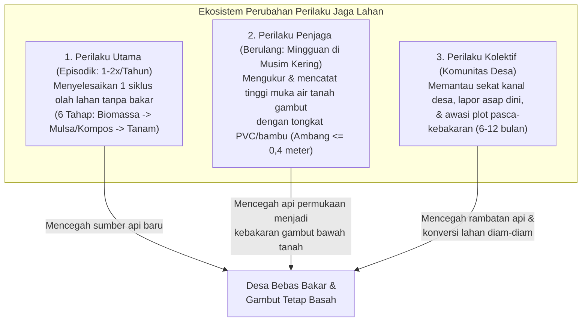

# Product Requirements Document (PRD) — Jaga Lahan

| Metadata Dokumen | Keterangan |
| :--- | :--- |
| **Nama Produk** | Jaga Lahan |
| **Tagline** | *Persuasi pada Keputusan yang Diambil Sekali Setahun* |
| **Bidang Aplikasi** | Lingkungan & Pertanian (Perlindungan Ekosistem Gambut Berbasis Komunitas Desa) |
| **Versi Dokumen** | `1.0.0` |
| **Status** | *Approved for Development* |
| **Penulis** | Iqbal Ahdagita Elbadra (`26MA41D022`) |

---

## 1. Ringkasan Eksekutif & Latar Belakang Masalah

Kebakaran hutan dan lahan (karhutla) di Indonesia bukanlah bencana alam yang muncul tiba-tiba, melainkan akumulasi keputusan manusia di ratusan ribu lahan kecil. Berdasarkan data **SiPongi Kementerian Kehutanan (2026)**:
- Luas areal terbakar periode **Januari–Juli 2026 mencapai 202.004,30 hektare**, meningkat **69%** dibanding periode yang sama pada 2025 dan **80%** dibanding 2023, tersebar di 36 provinsi dan 340 kabupaten.
- Sebanyak **91% area terbakar** (328.166 dari 359.619 ha pada 2025) berada di **lahan non-hutan** (lahan garapan, belukar, dan lahan terlantar), sementara hanya 9% di kawasan hutan.
- **Ketimpangan Ekologis Lahan Gambut:** Lahan gambut hanya mencakup **8,88%** dari luas area terbakar (Januari–September 2024), tetapi menyumbang **28,13% dari total emisi karbon** ($11{,}59\text{ juta}$ dari $41{,}20\text{ juta ton }\text{CO}_2\text{e}$). Setiap hektare gambut terbakar melepaskan emisi **4 kali lipat** tanah mineral karena api membara di bawah permukaan (*sub-surface peat fire*) saat muka air tanah turun melewati ambang batas **$0{,}4\text{ meter}$** (PP Nomor 57 Tahun 2016).
- **Akar Masalah Perilaku:** BNPB mencatat 99% karhutla disebabkan aktivitas manusia dan 80% lahan terbakar berubah menjadi kebun. Petani kecil memilih membakar bukan karena tidak tahu aturan (UU No. 32/2009 atau SE Menteri LH No. 16/2026), melainkan karena **membakar jauh lebih murah dan cepat** dibandingkan alternatif tanpa bakar yang menuntut biaya sewa alat pencacah, tenaga, dan waktu pengomposan.

### 1.1 Segmentasi Tiga Aktor Lapangan
| Aktor Lapangan | Karakteristik & Motivasi | Strategi Intervensi Jaga Lahan |
| :--- | :--- | :--- |
| **Kelompok 1: Petani Kecil Pragmatis** | Membakar karena keterbatasan modal, mahalnya sewa alat pencacah, dan waktu olah lahan yang sempit. | **Target Utama Persuasi:** Menurunkan biaya & hambatan kemampuan melalui kalkulator terbuka, panduan 6 tahap, dan akses prioritas bantuan alat dinas. |
| **Kelompok 2: Pengonversi Lahan Sengaja** | Membakar secara spekulatif untuk menguasai atau mengonversi lahan menjadi kebun dengan keuntungan besar. | **Pencegahan via Visibilitas Komunitas:** Tidak bisa dipersuasi hanya dengan lencana, sehingga diintervensi melalui fitur *Pantau Lahan Pasca-Kebakaran* selama 6–12 bulan oleh desa. |
| **Kelompok 3: Korban Rambatan Api** | Petani & warga yang tidak membakar, tetapi kebunnya ikut ludes akibat rambatan api dari kanal kering atau lahan tetangga. | **Target Perlindungan Kolektif:** Difasilitasi lewat pemantauan mingguan muka air tanah ($\le 0{,}4\text{ m}$), sekat kanal desa, dan pelaporan asap dini. |

---

## 2. Target Pengguna (Ekosistem Kerja Bersama Satu Desa)

Aplikasi dirancang untuk empat peran pengguna dalam satu ekosistem desa (`Role-Based Access Control`):

1. **Pengguna Primer (`pekebun_primer`) — Pekebun Rakyat Lahan Gambut:**
   - Mengelola 0,5 hingga 5 hektare sawit atau karet secara mandiri di Sumatera dan Kalimantan.
   - Menggunakan fitur kalkulator biaya, komitmen musim, panduan 6 tahap, tongkat ukur muka air mingguan, dan jurnal panen.
2. **Pengguna Sekunder (`petani_sekunder`) — Petani Pangan Lahan Kering Perbatasan Gambut:**
   - Mengelola tanaman semusim (jagung, padi gogo, sayuran) di desa yang sama.
   - Menggunakan kalkulator, panduan pengolahan sisa tanam menjadi mulsa/kompos, dan bergabung dalam kohort desa bebas bakar agar api tidak merambat ke kubah gambut.
3. **Pengguna Tersier (`penyuluh_tersier`) — Penyuluh Pertanian, Kader Desa, & Pemerintah Desa:**
   - Bertugas memverifikasi penyelesaian tahapan olah lahan dan laporan muka air, menindaklanjuti peringatan zona bahaya/asap, serta menyalurkan antrean bantuan alat pencacah/bibit penutup tanah dari dinas pertanian.
4. **Pengguna Penjaga Desa (`warga_penjaga`) — Masyarakat Umum Non-Pengolah Lahan:**
   - Guru, pemuda desa, tokoh masyarakat, dan ibu rumah tangga.
   - Memiliki 3 fungsi: (1) memantau muka air sekat kanal publik desa; (2) melaporkan indikasi asap sejak dini (foto tanpa koordinat individu + waktu + lokasi tingkat desa); dan (3) memantau plot bekas kebakaran selama 6–12 bulan. Menerima *Lencana Partisipasi Desa* tanpa dicampur dengan metrik hektare petani.

---

## 3. Spesifikasi Perilaku yang Diubah & Model Teoretis

Jaga Lahan membedakan tiga pola perilaku dengan frekuensi dan titik intervensi yang berbeda:

### Analisis *Fogg Behavior Model* ($B = MAT$)
- **Pada Perilaku Utama (Episodik):** Motivasi ($M$) tinggi menjelang musim tanam namun anjlok saat berhadapan dengan beratnya pekerjaan fisik. Kemampuan ($A$) terhambat oleh antrean alat pencacah dan waktu dekomposisi mulsa. Pemicu ($T$) dikirim pada **H-21, H-14, dan H-7** sebelum jadwal buka lahan dan langsung terhubung ke tombol pemesanan giliran alat desa.
- **Pada Perilaku Penjaga (Mingguan):** Motivasi ($M$) rendah karena menjaga air tetap tinggi tidak memberikan hasil panen instan hari itu. Kemampuan ($A$) ditingkatkan dengan mengganti sensor mahal menjadi **tongkat ukur pipa PVC/bambu 1 meter bertanda tiap 10 cm**, disertai umpan balik instan tiga zona warna.

---

## 4. Spesifikasi Fungsional Fitur Utama (8 Modul Inti)

### F-01: Onboarding Tiga Layar Berbasis Peran
- **Deskripsi:** Pendaftaran tanpa verifikasi surel berbelit. Pengguna memilih peran (`Petani` atau `Warga Penjaga Desa`).
- **Alur Petani (3 Layar):**
  1. Pilih komoditas (`Kelapa Sawit`, `Karet`, `Jagung/Padi Gogo`, `Hortikultura`) & jenis tanah (`Gambut` / `Mineral Perbatasan`).
  2. Masukkan luas lahan (hektare, $0{,}5\text{ – }5\text{ ha}$) dan pilih Desa/Kecamatan (tanpa meminta titik koordinat GPS).
  3. Tentukan perkiraan tanggal mulai buka/remajakan lahan $\rightarrow$ langsung mengarahkan pengguna ke **Kalkulator Bakar vs. Tanpa Bakar**.

### F-02: Kalkulator Bakar vs. Tanpa Bakar (Transparan & Terbuka)
- **Prinsip PSD & Persuasi:** *Reduction*, *Tailoring*, *Reciprocity*, Postulat Transparansi PSD.
- **Input:** Luas lahan (ha), komoditas, upah kerja harian lokal, dan ketersediaan sewa alat pencacah.
- **Output 2 Kolom Berdampingan (Ilustrasi Default 2 Hektare Sawit Rakyat):**
  - **Skenario Membakar:** Biaya langsung Rp1.200.000 (upah bakar) + Nilai hara hilang Rp1.000.000 = **Total Ekonomi Musim Pertama Rp2.200.000**.
  - **Skenario Tanpa Bakar:** Biaya langsung Rp3.500.000 (sewa cacah Rp2.000.000 + upah cacah & sebar mulsa Rp1.500.000) dikurangi Nilai hara dipertahankan Rp1.000.000 (penghemat pupuk musim berikut) = **Total Ekonomi Musim Pertama Rp2.500.000**.
- **Aturan Bisnis & Etis:**
  - Selisih **Rp300.000 lebih mahal** pada musim pertama untuk metode tanpa bakar ditampilkan secara jujur (tidak dimanipulasi), dan langsung memunculkan tombol **"Ajukan Subsidi / Pinjam Alat Pencacah Desa"** untuk menutup selisih tersebut.
  - Dilengkapi modal/drawer **"Lihat Rumus & Acuan Harga"** yang menampilkan rumus perhitungan secara transparan. Risiko sanksi hukum dipisahkan dari tabel biaya inti.

### F-03: Panduan Enam Tahap Olah Lahan Tanpa Bakar (*Tunneling*)
- **Prinsip PSD & Persuasi:** *Tunneling*, *Suggestion*, *Commitment & Consistency*, Komputer sebagai Alat & Media.
- **Daftar 6 Tahap Terpandu:**
  1. **Tahap 1 — Penilaian Biomassa & Pemesanan Alat:** Mengukur kepadatan semak/batang tua dan mengunci jadwal pinjam alat pencacah desa.
  2. **Tahap 2 — Pencacahan Mekanis/Manual:** Dilengkapi pemutar video demonstrasi singkat (40 detik) teknik mencacah limbah tebangan.
  3. **Tahap 3 — Penumpukan Jalur (*Windrowing*):** Menata hasil cacahan di gawangan mati agar jalur tanam bersih.
  4. **Tahap 4 — Pengomposan & Penebaran Mulsa:** Pemberian dekomposer/aktivator organik; memicu *suggestion* kontekstual (pengingat membalik kompos pada hari ke-10).
  5. **Tahap 5 — Pemeriksaan Kesiapan Tanam:** Mengecek suhu dan kelembapan tumpukan mulsa serta tinggi muka air gambut.
  6. **Tahap 6 — Penanaman Bibit:** Penyelesaian siklus dan pengajuan verifikasi penyuluh.
- **Kebebasan Pengguna (*Autonomy*):** Pengguna dapat melewati (*skip*) atau kembali ke tahap sebelumnya kapan saja tanpa dikunci paksa.

### F-04: Tongkat Ukur Muka Air Tanah Gambut (*Self-Monitoring*)
- **Prinsip PSD & Persuasi:** *Self-Monitoring*, *Reduction*, *Authority* (Acuan PP No. 57 Tahun 2016).
- **Cara Kerja:**
  - Menampilkan panduan membuat tongkat ukur dari pipa PVC/bambu 1 meter bertanda setiap $10\text{ cm}$.
  - Setiap minggu di musim kering, petani memasukkan angka kedalaman muka air (dalam $\text{cm}$ di bawah permukaan tanah) dan mengunggah foto opsional (dengan *auto-strip* EXIF).
- **Klasifikasi Tiga Zona Visual (Ambang $0{,}4\text{ meter} = 40\text{ cm}$):**
  - **Zona Aman ($0\text{ – }30\text{ cm}$):** Warna Biru-Hijau Teduh + Ikon Tetes Air Penuh + Pola Titik Halus. Gambut basah dan aman.
  - **Zona Waspada ($31\text{ – }40\text{ cm}$):** Warna Kuning Amber + Ikon Tanda Seru Segitiga + Pola Garis Diagonal. Mendekati batas kritis PP 57/2016.
  - **Zona Bahaya ($> 40\text{ cm}$):** Warna Oranye-Cokelat Gambut Kering (bukan merah penghakiman) + Ikon Perisai Peringatan + Pola Silang. Memunculkan **2 instruksi konkret**: *(1) Tutup sekat kanal terdekat* dan *(2) Hubungi penyuluh/kader desa*.
- **Visualisasi:** Grafik tren 4 minggu terakhir dengan garis batas horizontal jelas pada $40\text{ cm}$ ($0{,}4\text{ m}$).

### F-05: Jurnal Hasil Panen & Perbandingan Rata-Rata Desa
- **Prinsip PSD & Persuasi:** *Social Comparison*, *Social Proof*, *Self-Monitoring*.
- **Input:** Tanggal panen, jumlah hasil dalam satuan lokal (`Ton TBS`, `Karung`, atau `Rupiah`), catatan biaya pupuk, dan foto opsional.
- **Aturan Perbandingan Sosial Anti-Konflik:**
  - Menampilkan riwayat hasil lahan pengguna berdampingan dengan **rata-rata agregat hasil pekebun tanpa bakar di desa yang sama**.
  - **Tanpa *leaderboard* individu.**
  - **Aturan Privasi $N \ge 5$:** Rata-rata desa hanya ditampilkan jika terdapat minimal **5 pekebun pembanding** di desa tersebut; jika kurang dari 5, sistem otomatis menggabungkan rata-rata ke tingkat kecamatan.

### F-06: Kohort Desa & Lencana Kolektif (*Cooperation & Reward*)
- **Prinsip PSD & Persuasi:** *Cooperation*, *Reward*, *Reciprocity*, *Social Proof* (*Descriptive & Injunctive Norms*).
- **Lencana Kolektif Tingkat Desa:**
  1. **Desa Bebas Bakar:** Seluruh anggota kohort aktif menyelesaikan musim tanam tanpa titik bakar.
  2. **Sepuluh Hektare Tanpa Bakar:** Akumulasi luas lahan tanpa bakar terverifikasi di desa mencapai $\ge 10\text{ ha}$.
  3. **Musim Kedua Berturut-turut:** Keberlanjutan kohort desa selama 2 musim tanam beruntun.
- **Penghargaan Nyata bagi Petani:** Status prioritas peminjaman alat pencacah mekanis desa dan kuota bibit tanaman penutup tanah (*legume cover crop*) dari dinas pertanian, termasuk bagi petani yang menggunakan alat pinjaman desa.
- **Opsi Komitmen Privat:** Petani yang masih menunggu kepastian jadwal alat dapat memilih status *Komitmen Privat* sebelum siap tampil di kohort desa.

### F-07: Kalender Musim & Pengingat Pra-Keputusan (*Kairos*)
- **Prinsip PSD & Persuasi:** *Trigger*, *Kairos*, *Unobtrusiveness*.
- **Logika Pengingat:**
  - Mengirim notifikasi instruksional spesifik pada **H-21**, **H-14**, dan **H-7** sebelum tanggal buka lahan (contoh: *"Tiga hari lagi musim tanam. Sudah punya giliran alat pencacah?"*).
  - **Batas Eskalasi 3 Kali:** Jika 3 kali pengingat berturut-turut tidak direspons, notifikasi otomatis dihentikan agar tidak mengganggu (*unobtrusiveness*). Khusus untuk lahan gambut rawan tinggi, status 3 kali tanpa respons diteruskan ke dasbor penyuluh sebagai pengingat kunjungan pendampingan.
  - Selama musim kering, mode pengingat beralih ke pengingat mingguan pengukuran muka air tanah.

### F-08: Pantau Lahan Pasca-Kebakaran & Lapor Asap Dini + Verifikasi Penyuluh
- **Fitur Warga Penjaga Desa:**
  1. **Lapor Asap Dini:** Mengunggah foto indikasi asap, waktu, dan nama blok/desa (tanpa koordinat individu dan tanpa kolom tuduhan nama pemilik lahan) untuk diverifikasi kader/penyuluh.
  2. **Pantau Plot Pasca-Kebakaran (6–12 Bulan):** Menandai plot tingkat desa yang pernah terbakar dan mengunggah foto berkala untuk mencatat pemulihan vegetasi atau kemunculan patok/tanaman perkebunan baru agar desa dan penyuluh dapat mengklarifikasi status rehabilitasi lahan.
- **Fitur Verifikasi Penyuluh (`penyuluh_tersier`):**
  - Memverifikasi penyelesaian siklus 6 tahap dan log muka air (secara sensus untuk desa kecil atau sampel acak terstruktur berbatas waktu layanan/SLA untuk desa besar).

---

## 5. Metode Pengukuran Keberhasilan (Matriks 5 Lapis)

Aplikasi menyediakan dasbor analitik agregat (B2G) untuk memantau lima lapis indikator keberhasilan:

| Lapis Evaluasi | Indikator Utama | Target Tahun ke-1 | Sumber Data di Aplikasi |
| :--- | :--- | :--- | :--- |
| **Lapis 1: Adopsi Perilaku** | Persentase pengguna primer aktif yang menyelesaikan $\ge 1$ siklus olah lahan tanpa bakar terverifikasi penyuluh | **$\ge 60\%$** | Tabel `season_commitments` & `verifications` |
| **Lapis 2: Kepatuhan Proses** | Persentase tahap selesai tepat waktu dari 6 tahap & identifikasi tahap dengan *drop-off* tertinggi | **$\ge 70\%$** | Tabel `six_stage_progress` |
| **Lapis 3: Kepatuhan Muka Air** | Persentase minggu musim kering dengan tinggi muka air tercatat $\le 0{,}4\text{ meter}$ ($40\text{ cm}$) | **$\ge 75\%$** | Tabel `water_table_logs` |
| **Lapis 4: Luaran Lingkungan** | Total hektare gambut tanpa bakar terverifikasi, waktu respons laporan asap, & plot pasca-bakar terpantau | **$\ge 500\text{ ha}$** | Agregasi `villages`, `smoke_reports`, `post_fire_plots` |
| **Lapis 5: Kausalitas (DiD)** | Selisih perubahan titik panas (*hotspot*) & adopsi antara desa mitra vs. desa pembanding selama 2 musim | Penurunan signifikan | Komparasi kuasi-eksperimen lintas musim |
| **Retensi Lintas Musim** | Persentase pengguna primer yang kembali aktif pada musim tanam berikutnya (*re-activation rate*) | **$> 40\%$** | Log kohort musim ke-1 vs. musim ke-2 |

