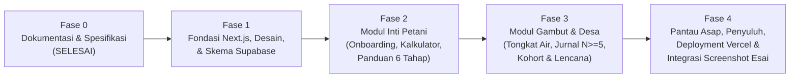

# Peta Jalan Pengembangan (Product & Engineering Roadmap) — Jaga Lahan

**Proyek:** Jaga Lahan  
**Versi Dokumen:** 1.0.0  
**Target Penyelesaian:** Aplikasi Web Interaktif Full-Stack (Next.js + Supabase + Vercel) + Tangkapan Layar UI untuk Dokumen Esai  

---

## 1. Gambaran Umum Tahapan Pengembangan

Pengembangan **Jaga Lahan** dibagi ke dalam **5 Fase Terstruktur** agar setiap fitur yang tertulis di dalam esai (*Tugas 1 Persuasive Technology*) memiliki implementasi kode yang nyata, teruji di basis data Supabase, ter-deploy di Vercel, serta terdokumentasi di GitHub.

---

## 2. Rincian Fase dan Daftar Tugas (Deliverables)

### Fase 0 — Dokumentasi & Spesifikasi Produk (`docs/`) — ✅ SELESAI
- [x] Penyusunan [`README.md`](file:///D:/S2%20Amikom/Persuasive%20Technology/JagaLahan/docs/README.md) sebagai indeks pusat dokumentasi proyek.
- [x] Penyusunan [`PRD.md`](file:///D:/S2%20Amikom/Persuasive%20Technology/JagaLahan/docs/PRD.md) yang merangkum masalah karhutla, 4 peran pengguna desa, matriks $B = MAT$, 8 fitur inti (`F-01` s.d. `F-08`), dan 5 lapis metrik evaluasi.
- [x] Penyusunan [`ARCHITECTURE.md`](file:///D:/S2%20Amikom/Persuasive%20Technology/JagaLahan/docs/ARCHITECTURE.md) yang mendefinisikan arsitektur PWA luring, pipeline penghapusan EXIF GPS di sisi klien, dan struktur direktori Next.js.
- [x] Penyusunan [`DATABASE_SCHEMA.md`](file:///D:/S2%20Amikom/Persuasive%20Technology/JagaLahan/docs/DATABASE_SCHEMA.md) lengkap dengan ERD, DDL PostgreSQL 12 tabel, *View* privasi $N \ge 5$, dan kebijakan RLS.
- [x] Penyusunan [`DESIGN_SYSTEM.md`](file:///D:/S2%20Amikom/Persuasive%20Technology/JagaLahan/docs/DESIGN_SYSTEM.md) untuk warna kontras matahari, aksesibilitas buta warna 3 zona air gambut, dan spesifikasi 7 layar utama.
- [x] Penyusunan [`ETHICS_AND_PRIVACY.md`](file:///D:/S2%20Amikom/Persuasive%20Technology/JagaLahan/docs/ETHICS_AND_PRIVACY.md) sesuai UU PDP No. 27/2022 dan kerangka Berdichevsky & Neuenschwander (1999).
- [x] Penyusunan [`ROADMAP.md`](file:///D:/S2%20Amikom/Persuasive%20Technology/JagaLahan/docs/ROADMAP.md) dan [`CHANGELOG.md`](file:///D:/S2%20Amikom/Persuasive%20Technology/JagaLahan/docs/CHANGELOG.md).

---

### Fase 1 — Inisialisasi Proyek Next.js, Sistem Desain, & Integrasi Supabase — ✅ SELESAI
- [x] Inisialisasi proyek **Next.js (App Router, TypeScript, Tailwind CSS)** di dalam folder `D:\S2 Amikom\Persuasive Technology\JagaLahan`.
- [x] Konfigurasi komponen dasar **Shadcn UI**, ikon `lucide-react`, dan grafik.
- [x] Penyalinan aset resmi `JagaLahan Logo.png` ke `public/logo-jagalahan.png` dan pembuatan `src/app/manifest.ts` (PWA).
- [x] Penyusunan migrasi SQL pada [`supabase/migrations/001_initial_schema_and_seed.sql`](file:///D:/S2%20Amikom/Persuasive%20Technology/JagaLahan/supabase/migrations/001_initial_schema_and_seed.sql) (12 tabel + *View* `v_safe_harvest_aggregates`).
- [x] Pengisian *seed data* realistis untuk 3 desa percontohan:
  1. **Desa Kalampangan** (Kec. Sabangau, Kota Palangka Raya, Kalimantan Tengah — wilayah gambut dengan $N = 14$ petani aktif, memenuhi syarat $N \ge 5$).
  2. **Desa Rantau Panjang** (Kec. Koto Gasib, Kab. Siak, Riau — wilayah transisi dengan $N = 3$ petani aktif, untuk mendemonstrasikan mekanisme *fallback* privasi $N < 5$ ke tingkat Kecamatan).
  3. **Desa Buatan Baru** (Kec. Koto Gasib, Kab. Siak, Riau — wilayah dengan 2 musim tanpa bakar berturut-turut).
- [x] Pembuatan *App Shell* responsif dengan bilah status privasi (`🔒 Tanpa GPS · EXIF dibersihkan`), indikator mode luring/daring, dan *Role Switcher* (Pekebun Primer, Petani Sekunder, Penyuluh Tersier, Warga Penjaga).

---

### Fase 2 — Implementasi Modul Inti Petani (`F-01`, `F-02`, `F-03`) — ✅ SELESAI
- [x] **Modul `F-01` (Onboarding 3 Layar & Persetujuan Privasi):**
  - Alur masuk cepat tanpa verifikasi email rumit, pemilihan desa & jenis tanah, serta penjelasan hak privasi UU PDP No. 27/2022.
- [x] **Modul `F-02` (Kalkulator Bakar vs. Tanpa Bakar):**
  - Mesin perhitungan biaya 2 kolom (contoh baku 2 ha: `Rp2.200.000` vs. `Rp2.500.000` di musim pertama + proyeksi penghematan pupuk musim kedua `Rp800.000`).
  - Modal transparansi rumus perhitungan & acuan harga lokal yang diverifikasi penyuluh.
  - Lembar pengajuan cepat (*One-Tap Sheet*) untuk peminjaman alat pencacah desa & bibit penutup tanah guna menutup selisih biaya `Rp300.000`.
- [x] **Modul `F-03` (Panduan 6 Tahap Pembukaan Lahan Tanpa Bakar):**
  - *Stepper* interaktif 6 tahap dengan tombol non-koersif *"Lewati / Kembali"*.
  - Simulasi pemutar video peragaan pencacahan 40 detik hemat kuota & kartu pengingat pembalikan mulsa hari ke-10.
  - Komponen unggah foto dengan pembersih `EXIF GPS` berbasis `HTML5 Canvas` yang menampilkan bukti verifikasi bebas koordinat lokasi.

---

### Fase 3 — Implementasi Modul Gambut & Komunitas Desa (`F-04`, `F-05`, `F-06`, `F-07`) — ✅ SELESAI
- [x] **Modul `F-04` (Tongkat Ukur Muka Air Tanah Gambut):**
  - Visualisasi interaktif tongkat ukur 1 meter (skala 10 cm) dan grafik tren 4 minggu terhadap batas kritis **$0,4\text{ meter}$ ($40\text{ cm}$ — PP No. 57 Tahun 2016)**.
  - Penerapan 3 zona ramah buta warna (Warna + Ikon + Pola) dan tampilan minggu terlewat berwarna abu-abu netral non-menghakimi.
  - Kartu 2 tindakan konkret saat kedalaman air $> 40\text{ cm}$ (Tutup Sekat Kanal & Hubungi Penyuluh Desa).
- [x] **Modul `F-05` (Jurnal Hasil Panen & Perbandingan Agregat Desa $N \ge 5$):**
  - Formulir pencatatan panen dengan satuan lokal (Karung, Ton/ha, Rupiah).
  - Grafik perbandingan hasil sendiri terhadap rata-rata desa (tanpa *leaderboard* individu) dan demonstrasi sakelar privasi $N \ge 5$ vs. *fallback* Kecamatan ($N < 5$).
- [x] **Modul `F-06` & `F-07` (Kohort Desa, Lencana Kolektif, & Kalender Pra-Keputusan):**
  - Papan capaian hektare tanpa bakar tingkat desa, 3 lencana kolektif desa, dan sakelar privasi komitmen (Publik di Desa vs. Pribadi).
  - Kalender musim tanam dengan pratinjau pemicu **H-21, H-14, dan H-7** serta indikator aturan berhenti otomatis setelah 3 kali diabaikan.

---

### Fase 4 — Modul Pantau Asap, Verifikasi Penyuluh, & Deployment (`F-08`) — ✅ SELESAI
- [x] **Modul `F-08` (Lapor Asap Dini, Pantau Lahan Pasca-Kebakaran 6–12 Bulan, & Panel Penyuluh):**
  - Formulir lapor asap dini tingkat blok/desa dan linimasa pemantauan pemulihan petak pasca-kebakaran selama 6–12 bulan.
  - Dasbor Penyuluh Tersier untuk memverifikasi tahap petani, menjadwalkan gilir alat pencacah desa, dan memperbarui harga acuan kalkulator.
- [ ] **Push ke GitHub & Deployment Produksi ke Vercel:**
  - Inisialisasi repositori Git, *push* ke GitHub, dan koneksi otomatis ke Vercel dengan variabel lingkungan Supabase.
- [ ] **Pengambilan Tangkapan Layar UI (Opsional / Peningkatan Esai):**
  - Mengambil tangkapan layar beresolusi tinggi dari aplikasi yang telah berjalan untuk disisipkan ke dalam dokumen esai bila diperlukan.

